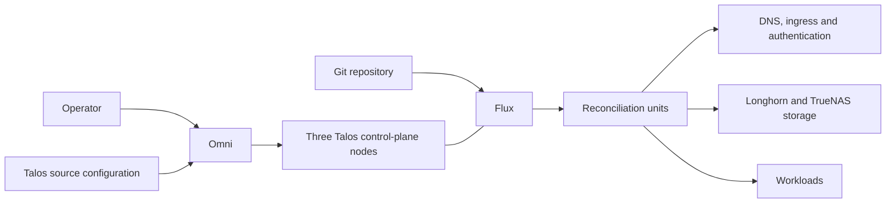

# Talos Homelab

An opinionated example of running a small Kubernetes homelab like a production
platform—without importing the full weight of an enterprise environment.

The cluster combines Talos Linux, Omni and Flux to keep infrastructure
reproducible, ownership boundaries explicit and recovery practical. It is built
around three control-plane nodes and is designed to keep its shared platform
path available when one Kubernetes node fails. These are three physical mini PCs
running Talos directly on bare metal, not virtual machines on TrueNAS. The NAS
is a separate storage system; each Talos node has its own non-system NVMe
volume for Longhorn data.

This repository is a working system rather than a turnkey distribution. Its
most reusable parts are the design choices: separating machine lifecycle from
cluster state, making reconciliation dependencies visible, and treating
failure and recovery as properties to test.

## Why this exists

Homelabs often grow from a collection of manual installations into
infrastructure that matters. By that point, undocumented state, implicit
dependencies and untested recovery paths make even routine maintenance risky.

This project explores a more deliberate operating model:

- Git is the source of truth for persistent Kubernetes state.
- Non-secret Talos configuration is reviewable and reproducible.
- Controllers and workloads reconcile independently through Flux.
- Dependencies are explicit instead of hidden in an installation sequence.
- Availability and recovery claims are documented and exercised.
- Credentials and generated machine configuration stay outside Git.

## Architecture



The two paths intentionally have different responsibilities. Omni manages
machine lifecycle and applies the Git-tracked Talos source configuration. Flux
reconciles persistent Kubernetes state from this repository. Generated Talos
configuration, machine identities and bootstrap credentials remain outside the
repository.

## Design principles

### Clear ownership boundaries

Flux Git owns Kubernetes desired state; the private homelab-secrets Git source holds Omni templates, while Omni owns machine
lifecycle and Talos applies the operating-system configuration. This avoids a
second, manually maintained source of truth without forcing secret machine
identity material into Git.

### Explicit reconciliation

Platform capabilities and user workloads are packaged as independently owned
Flux reconciliation units. Hard prerequisites are expressed with `dependsOn`,
so the deployment graph remains visible and reviewable instead of relying on a
broad infrastructure phase or operator memory.

### Designed failure posture

The three-node topology targets continued operation of the shared platform path
after the loss of one Kubernetes node. That claim is deliberately narrower than
"everything is highly available": individual stateful workloads may have a
bounded interruption, and external systems such as TrueNAS remain separate
failure domains.

### Practical recovery

Bootstrap secrets, control-plane recovery, storage backups and application
restore procedures are treated as part of the architecture. Historical failure exercises record the boundaries actually tested; current
recovery capabilities remain separate from steady-state manifest validation.

## Failure and storage model

The cluster uses two complementary storage patterns:

- **Longhorn** provides replicated block storage managed by the cluster. Three
  replicas across three nodes preserve a healthy copy set after one node is
  lost.
- **TrueNAS-backed NFS** provides shared or static NAS storage for data whose
  lifecycle and performance profile fit an external storage system.

This split is intentional. Longhorn protects against a Kubernetes-node failure;
TrueNAS-backed storage depends on the NAS and LAN. Neither should be mistaken
for off-site disaster recovery.

## Repository tour

```text
.
├── kubernetes/
│   ├── clusters/talos-home/  # Flux entrypoint and top-level ordering
│   ├── flux/repositories/    # sources shared by several units
│   ├── kustomization.yaml    # reconciliation unit registry
│   ├── applications/         # user-facing services
│   ├── infrastructure/       # platform capabilities (networking, storage, operators)
│   └── observability/        # metrics, logging and telemetry
├── scripts/                  # validation, audits and failure-test tooling
└── docs/                     # architecture and operational runbooks
```

The categories are organizational only: they are not Flux deployment
phases, ownership layers or dependency tiers.

The Kubernetes reconciliation chain is intentionally small:

```text
repositories -> reconciliation unit registry -> unit-level reconciliation
```

Each unit owns its namespace, Flux Kustomization and nested workload resources
unless a documented platform boundary requires otherwise.

## Operations and documentation

Start with [architecture](docs/architecture.md) for ownership,
network/storage failure domains and Flux/Omni separation; read
[GitOps](docs/gitops.md) for reconciliation rules,
[cluster maintenance](docs/maintenance.md) before node/version work,
and [bootstrap and recovery](docs/bootstrap.md) before restoration.

| Operational area | Primary guide |
| --- | --- |
| Native Renovate and Hermes schedules | [Automation](docs/automation.md) and [nightly policy](docs/renovate-review-policy.md) |
| TrueNAS encrypted Apps startup recovery | [NAS recovery runbook](docs/truenas-app-recovery.md) |
| Longhorn charts, engines, replicas and recovery | [Storage upgrades](docs/longhorn-upgrade.md) and [recovery inventory](docs/recovery-ownership-inventory.md) |
| Talos, Omni and encrypted etcd | [private Talos source](https://github.com/AgenticHomelab/homelab-secrets/blob/main/talos/README.md) and [etcd backups](docs/etcd-backups.md) |
| OCI-hosted observability senders | [Talos metrics](docs/talos-metrics.md) and [scoped logs](docs/talos-logs.md) |
| Privileged agent boundaries | [Hermes operations](docs/hermes.md) and [agent policy](docs/agents/operating-model.md) |
| Private photo application | [Immich operations and paired recovery](docs/immich.md) |
| Matrix services and identity | [Matrix operations](docs/matrix.md), [Signal](docs/matrix-signal.md) and [WhatsApp](docs/matrix-whatsapp.md) |
| Public/private service exposure | [Service audience](docs/service-exposure.md) |
| Availability model and evidence | [High availability](docs/high-availability.md) and [failure testing](docs/ha-failure-testing.md) |

Dated acceptance reports, research, experiment plans and detailed
upgrade execution records are not routine runbooks. They retain
separate evidence boundaries and do not supersede current Git,
live state or these primary operational guides.

## Scope

This repository reflects one production-like personal environment. Its
hardware, network, DNS, storage systems and secrets are environment-specific,
so cloning it is not an installation procedure. Use it as a reference for
structure, trade-offs and operational discipline; adapt those ideas to your own
failure domains and recovery requirements.
